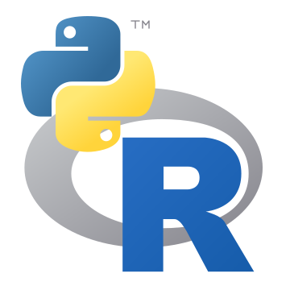

<div align="center">

<h1></h1>

**R, ready to roll.**

A complete R runtime in a Python wheel.

[](https://pypi.org/project/r4py/)
[](https://www.python.org/)
[](https://www.r-project.org/)
[](https://github.com/JGalego/r4py/actions/workflows/wheels.yml)
[](#install)
[](#licensing)

</div>

No system R installation. No runtime dependencies on Python packages. No downloads on import. No changes to your process environment.

## Install

```sh
pip install r4py
```

Wheels contain R **4.6.2**, base and recommended packages, `libR`, headers, help files, and `R CMD` tools. The Windows wheel omits the CRAN uninstaller and combined reference-manual PDF; individual package help and manuals remain included. Version `4.6.2.3` means R `4.6.2`, packaging revision `3`.

The release workflow targets:

| Platform | Architectures |
| --- | --- |
| Linux, glibc 2.28+ | x86-64, ARM64 |
| macOS 15+ | Intel, Apple Silicon |
| Windows 10+ | x86-64 |

Linux wheels are repaired with auditwheel; macOS wheels with delocate. Alpine/musl and Windows ARM64 are not supported. Python 3.10+ is required.

## Why r4py?

| | r4py | System R / conda R | rpy2 |
| --- | --- | --- | --- |
| Install | `pip install r4py` | OS package manager or conda | needs an existing R |
| Bundles R | yes | yes | no |
| Python-to-R object bridge | no | no | yes |
| Best for | running `R`/`Rscript` from Python projects and CI | general R work | in-process R calls |

r4py pairs well with rpy2 when you want a pinned R runtime and an object bridge.

## Python

```python
from subprocess import run
from r4py import R, R_HOME, R_VERSION, RSCRIPT

print(R_HOME)  # pathlib.Path to the bundled R installation
print(R_VERSION)  # (4, 6, 2)

run([RSCRIPT, "--vanilla", "-e", "cat(mean(1:10))"], check=True)
run([RSCRIPT, "analysis.R", "input.csv"], check=True)
run([R, "CMD", "config", "CC"], check=True)
```

The executables locate their own runtime, even if the environment is moved. To override a system R environment or configure a child process:

```python
from r4py import get_env

run(
    [RSCRIPT, "--vanilla", "-e", "cat(R.home())"],
    env=get_env({"R_LIBS_USER": "/path/to/my/R/library"}),
    check=True,
    capture_output=True,
    text=True,
)
```

`get_env()` copies `os.environ`, applies your overrides, then sets the bundled R home, include, share, and documentation paths. It removes inherited R sub-architecture and R loader overrides. It never changes `os.environ`.

This is a runtime distribution, not a Python-to-R object bridge. Use subprocesses, files, or an independently installed bridge such as rpy2.

Check the installed version with `r4py.__version__` (packaging version, e.g. `4.6.2.3`) or `R_VERSION` (bundled R, e.g. `(4, 6, 2)`). `r4py --version` is passed through to Rscript and reports R's own version.

## Command line

```sh
r4py --vanilla -e 'cat(mean(1:10))'
r4py analysis.R input.csv
python -m r4py --vanilla -e 'cat(R.version.string)'
r4py-r                         # interactive R
r4py-r CMD config CC
```

`r4py` runs Rscript. `r4py-r` runs R. Arguments, standard streams, and exit codes are passed through. The launchers do not silently select a system R. R startup files behave normally; use `--vanilla` for isolated execution.

## R packages

Recommended packages, including Matrix, MASS, survival, and lattice, are already included. Install additional packages into a **writable library outside the wheel**:

```sh
r4py --vanilla -e 'lib <- path.expand("~/r4py-library"); dir.create(lib, recursive=TRUE, showWarnings=FALSE); install.packages("jsonlite", lib=lib, repos="https://cloud.r-project.org")'
```

Set `R_LIBS_USER` to that directory for subsequent runs. Package installation uses the network. Unix wheels include a CA certificate bundle so HTTPS downloads do not depend on the build machine's certificate paths; set `CURL_CA_BUNDLE` to use your own PEM certificate bundle. Compiling source packages requires native build tools and any package-specific system libraries; Windows uses Rtools. `R CMD config` also requires make on Unix. These tools are not bundled. Neither RStudio nor a desktop GUI is included. Headless PDF and PNG graphics are supported.

## Troubleshooting

- **`No matching distribution found`**: wheels require Python 3.10+, glibc 2.28+ on Linux, and macOS 15+. Alpine/musl and Windows ARM64 are unsupported; pip falls back to the source distribution, which contains no R.
- **`bundled R is missing`**: you installed the source distribution or are running from a checkout. Install a platform wheel or run `build_r_runtime.py`.
- **Wrong R or library picked up**: use `get_env()` for child processes, and `--vanilla` to skip user startup files.
- **Package compilation fails**: install native build tools (Rtools on Windows); they are not bundled.

## Build and test

```sh
uv sync --no-install-project
uv run --no-sync ruff check .
uv run --no-sync pyright
uv run --no-sync pytest -m 'not runtime'
uv run --no-sync python build_r_runtime.py
uv build --wheel
```

Optional: install the git hooks with `uvx pre-commit install`. They run ruff, pyright and basic file checks; `uv sync --no-install-project` must have been run first for pyright.

Unix builds need a C/C++/Fortran toolchain, make, tar, a CA certificate bundle, and development files for curl, bzip2, xz, zlib, PCRE2, ICU, readline, Cairo, PNG, JPEG, and TIFF. For example, use the manylinux container recipe in [the wheel workflow](.github/workflows/wheels.yml). `--jobs N` controls compilation parallelism. `--source-archive PATH` uses a local tarball with the same pinned SHA-256 verification.

On Windows, or to reuse a native R installation:

```sh
uv run --no-sync python build_r_runtime.py --runtime /path/to/R/home
```

The builder checks the R version, copies the installation, and makes the Unix launchers relocatable. It refuses to overwrite an existing runtime. Wheel builds fail if the runtime is missing or the R version does not match. Source distributions contain build tooling, **not** R.

Local builds inherit the host's OS and library requirements. On Unix, repair the wheel before distributing it; the release workflow does this automatically. For a local Linux build:

```sh
AUDITWHEEL_LD_LIBRARY_PATH="$PWD/src/r4py/r-runtime/lib" \
  uvx --from auditwheel --with patchelf auditwheel repair --strip \
  -w wheelhouse dist/r4py-*.whl
```

```sh
uv run --no-sync pytest
R4PY_REQUIRE_RUNTIME=1 uv run --no-sync pytest -m runtime
uv run --no-sync python tests/smoke_wheel.py wheelhouse/r4py-*.whl
```

Without a built runtime, integration tests skip. Release CI requires them, installs each repaired wheel in a path with spaces, hides the original runtime, and tests R execution, recommended native packages, graphics, `R CMD` on Unix, user-library package installation, and exit codes.

## Licensing

r4py's Python code is MIT licensed. Bundled R is **GPL-2.0-or-later**; its packages and linked libraries retain their own licenses. Do not treat the wheel as MIT-only. The Unix wheel recipes retain dependency license notices and the exact RPM or Homebrew source-package inventory.

R source: [R-4.6.2.tar.gz](https://cran.r-project.org/src/base/R-4/R-4.6.2.tar.gz) (SHA-256 `c297040f6392b1dac6e5c0eb398422cfdaedf540ae2205edb9ad0d10cb10ee00`). The build script contains the launcher modifications and is also included in the bundled runtime. Preserve R's `COPYING` and package notices when redistributing. Binary redistribution must comply with R and dependency source-distribution requirements; linking or embedding R may impose further GPL obligations.

The logo, shown above and included in the [source distribution](https://pypi.org/project/r4py/#files), combines the [Python two-snakes device](https://www.python.org/community/logos/), a trademark of the Python Software Foundation, with the [R logo](https://www.r-project.org/logo/), copyright 2016 The R Foundation. The R artwork and composite arrangement are [CC BY-SA 4.0](https://creativecommons.org/licenses/by-sa/4.0/); the R artwork is scaled and layered with the Python device. The Python device retains its original shape and colors and remains subject to the [PSF trademark usage policy](https://www.python.org/psf/trademarks/). Neither foundation's endorsement is implied.

## Releases and PyPI

Release each supported stable R version separately: r4py `4.6.2.3` and tag `v4.6.2.3` bundle R `4.6.2`, with packaging revision `3`. Packaging-only fixes increment the fourth component. Keep previous releases available so users can pin their R runtime.

For the first PyPI upload, add a pending publisher at [PyPI account publishing](https://pypi.org/manage/account/publishing/):

| Field | Value |
| --- | --- |
| PyPI project name | `r4py` |
| Repository owner | `JGalego` |
| Repository name | `r4py` |
| Workflow filename | `wheels.yml` |
| Environment name | `pypi` |

The workflow's display name is **Wheels**, but PyPI needs its filename, `wheels.yml`, without the `.github/workflows/` prefix. No PyPI API token is needed.

A release tag builds and tests the source distribution and five wheels without publishing. Once trusted publishing is configured and the release's corresponding source materials are available, run **Wheels** manually on that tag with **publish** enabled:

```sh
gh workflow run wheels.yml --ref v4.6.2.3 -f publish=true
```

Publishing uses the `pypi` GitHub environment. Add required reviewers if the repository's billing plan supports them; otherwise the explicit manual publish input is the release gate. Before publishing, verify third-party notices and make the exact corresponding sources for R and bundled dependencies available alongside the binaries.
